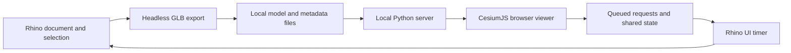

# Architecture

EarthLink has two processes: Rhino owns the document and geometry; a local Python server serves the browser and exchanges small JSON files with Rhino. The server listens on `127.0.0.1`; browser changes are queued for Rhino to apply on its UI timer.

| Component | Responsibility |
| --- | --- |
| `commands/` | Four Rhino entry points: send, viewer, sync, settings |
| `earthlink/core.py` | EarthAnchorPoint frame, design-set membership, headless GLB export, transformations, Earth Pro KML |
| `earthlink/views.py` | Perspective, two-point, and parallel cameras; two-way named-view reconciliation |
| `earthlink/sync.py` | Eto UI timer for live sets, cameras, anchor requests, sun, and named views |
| `earthlink/server.py` | Separate server process, local API, server-sent events, capture/share output |
| `earthlink/env.py` | Paths, defaults, settings, and OS helpers |
| `earthlink/geometry.py` | Final GLB to ENU-metre mesh sidecar for the map cutout, with node transforms baked |
| `shared/viewer/navigation.js` | Rhino navigation on the globe: one action per gesture (pinch/scroll latching, device correction, glide fade), a pivot kept between rotations, easing, level horizon, Two-Point as a level-axis rendering of the same camera, scale-aware pan/zoom; also `daylight()` (tint, shadow strength and sky colour by sun height) |
| `shared/viewer/footprints.js` | Plan outline of each set's base for "Hide map underneath": triangles cut 1 cm above the lowest point, painted on a grid, edges traced and straightened, in a worker; returns the base's boundary rings, which `buildCutMask` in index.html rasterises into the map shader's mask |
| `shared/viewer/walk.js` | Walking: a 1.80 m person on whatever is drawn (map or model), probed by rays each frame |
| `earthlink/collada.py` | GLB to Z-up COLLADA conversion for Earth Pro |
| `shared/viewer/index.html` | Viewer UI and CesiumJS integration; no frontend build step |
| `tools/build.py` | Rhino Script Editor build and Yak manifest/package finishing |

Geometry is exported in metres in a local east/north/up frame around the EarthAnchorPoint. Project identity and design-set membership are stored in Document User Text. Local runtime settings, credentials, views, and exchange files live in the user's application-data folder, outside the repository.

## Design constraints

- No Python background threads inside Rhino. Keep the server in its own process and document work on the UI timer.
- Export through a headless document so temporary export geometry does not enter the working model.
- Keep reciprocal features consistent: viewer location changes must reach EarthAnchorPoint, for example.
- Use `tools/build.py` because the Rhino command-line launcher requires a space-free build path.
- Keep the `.rhproj` library base as `earthlink/` and retain rendered 24-pixel light/dark command icons.

## Known preview issues

1. Ground height is currently a global setting and may carry over when switching projects. Re-sample at the new site.
2. A live set emptied by deleting all its objects can retain its last exported geometry. Remove the set from the viewer to clear it.
3. Browser-only exports can prune an older COLLADA file still referenced by Earth Pro. Re-export to Earth Pro.
4. The author reports testing public 0.1.0 in Rhino 8. Version 0.1.1 changes release metadata and documentation only; Windows validation remains unverified.

The first three issues remain outside the viewer redesign. Windows acceptance is still pending.

## Viewer state and resources

`navigation.js` owns the camera: gestures latch one mode per gesture (including momentum; a stray pinch inside a scroll gesture is skipped), the pivot is what is at the centre of the view when a rotation starts and is reused while only rotations have moved the camera, motion is eased per frame and the horizon is re-levelled after every move. It works in world space, so it needs no site or model. Walk owns its own frame (east/north/up at the point you click) and returns to the prior camera on exit. Follow, site picking, set dragging, measurement and walking do not concurrently own input. Geometry/display changes leave walking. Two-Point is not a separate navigation mode: gestures act on the true camera (`pose()`), and `setPose` draws it with a level axis and the pitch as lens shift (`frustum._elShift`, at most tan 65°).

Each export optionally references a schema-1 geometry.json beside model.glb: ENU-metre vertices and triangle indices derived from the final GLB. A worker derives the base's boundary rings. "Hide map underneath" is a `Cesium.CustomShader` on the map tileset (attached when the map opens), not clipping polygons and not a separate patch: one RGBA mask in the site frame (R grade weight, G inside a base, B+A base height in cm) is sampled in the vertex shader to grade the map's ground to the base and in the fragment shader to discard what is inside it; the same shader multiplies the map's colour by the time-of-day tint. Its site matrices are computed per draw from `scene.context.uniformState` (overriding `customShader.uniformMap` entries), so the shadow pass, which draws with the sun's camera, deforms the map identically. `cutAt()` applies the same mask to CPU ray hits. A render error with the shader attached reloads once without it (`sessionStorage earthlink:noMapShader`). Missing or failed sidecars produce a resend message, never a rectangular mask. Share archives and Rhino project resources explicitly include the viewer modules and licensed runtime libraries.

Sun state includes enabled, UTC, timezone offset, source and project. Rhino is authoritative on sun-sync startup. Off uses neutral headlight illumination with no dynamic cast shadows; retained times do not reactivate it. JSON writes use unique temporary files and atomic replacement; viewer settings writes are serialized. The separate server may use request threads; Rhino uses no background Python threads.

Model lighting is calibrated against Rhino 8's Rendered mode (`LIGHT` in index.html: sun 3.8, an even sky light given as spherical harmonics, shadow darkness 0.65), measured on colour swatches in both. After the per-material merge, `geometry.screen_materials` rewrites what a real-time viewer cannot show: `KHR_materials_transmission` becomes alpha blending, and metals are capped at metallic 0.3. `_export_glb` copies each object's texture mappings to the export copy (`_copy_texture_mappings`); without them a box-mapped texture falls back to surface UVs. Named views are always reconciled (no setting); `views.cam_to_vi` builds a `ViewportInfo` for all three projections without touching a visible viewport. A first placement sets the EarthAnchorPoint's model base point to the bottom centre of the sent objects (`core.base_point_for`), only when the anchor is new and the base point is at the origin.

Surface queries (orbit pivot, walking, walk placement) are CPU ray tests: EarthLink's own exported mesh through a uniform grid, and Google tiles through `tile.content.pick` limited to tiles within the probe's reach, with Cesium's GPU read-backs kept in memory for the session. Map hits are moved by what the cut-out shader does there (`cutAt`). These use Cesium 1.140 internals (`_selectedTiles`, `Buffer.getBufferData`, the orthographic width adjustment, shadow bias, `CustomShader.uniformMap`, `uniformState`), so an engine upgrade needs the browser checks again. Walking results are navigation aids, not geometric or accessibility validation.

Design-set placement is a rotation about vertical (degrees clockwise on the map) plus a translation in east/north/up metres, `{rot, t}`. Exports are always unplaced (`unplaced: true` in the set's meta entry): the viewer multiplies the site frame by the placement, so a move is instant and exports nothing. The viewer posts the absolute placement (`/api/sets` op `place`); the server queues it for Rhino, then writes it into `meta.json`; Rhino stores it in Document User Text and republishes its own copy when the two differ (Undo, a reopened file) and no request is waiting. Entries without `unplaced` (before 0.2.0-beta.9) have the placement baked in and are sent once more. A site change that leaves the base point and north unchanged rewrites `meta.anchor` only. `geometry.compose_placement` remains for relative moves queued by older viewers.
