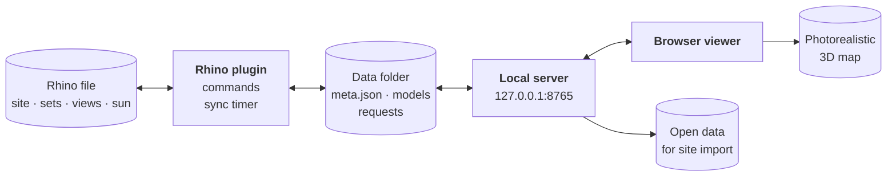
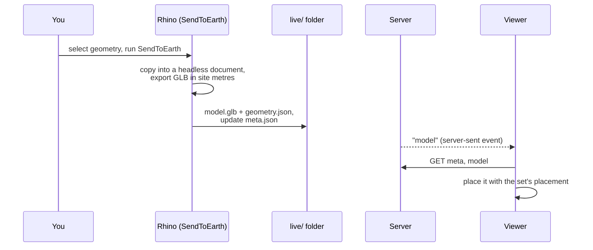
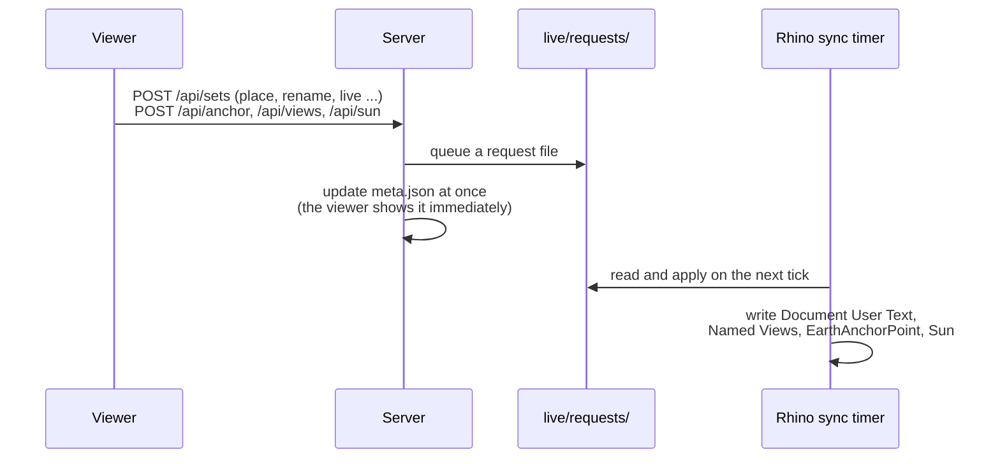
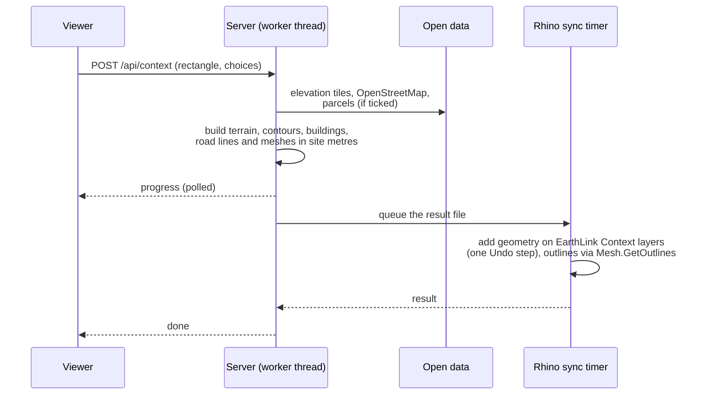
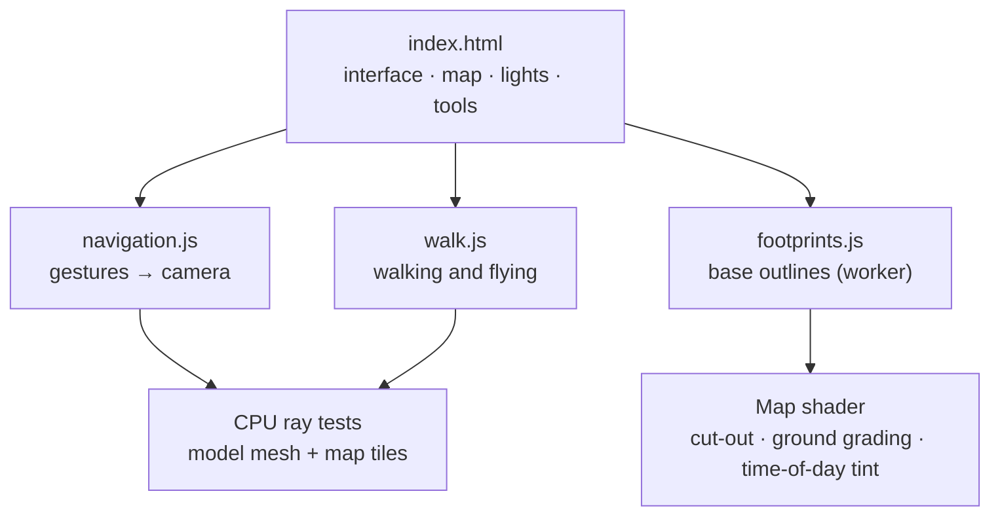

# Architecture

EarthLink has three parts:

- **Rhino plugin.** It owns the document. It exports geometry and applies every change to the Rhino file.
- **Local server.** A separate Python process on `127.0.0.1:8765`. It serves the viewer and its API, and passes messages between Rhino and the browser through small files.
- **Browser viewer.** CesiumJS with EarthLink's navigation, lighting and tools, with no build step.



Rhino never waits on the network and never runs Python background threads. Everything that touches the document happens on the sync timer. Everything slow (serving, downloading) happens in the server process.

## How things move

### Sending a model



The export copies the objects into a headless document, so nothing temporary enters your model. Geometry is written in metres, east / north / up of the EarthAnchorPoint. A Live set is watched by the sync timer and exported again about a second after Rhino goes idle.

### A change made in the viewer

The viewer never writes the Rhino file. It asks, and Rhino applies the change on its next tick.



A design set's placement is two numbers kept with the set: a rotation about vertical and an east / north / up offset. The viewer applies them on top of the exported geometry, so moving a set exports nothing and never moves Rhino geometry.

### Surroundings to Rhino



All downloading and geometry building is pure Python in the server process (`earthlink/context.py`). Rhino only turns the finished data into objects (`core.add_context`). Road surfaces are meshes cut to the rectangle and laid on the ground. Road outlines are the outline of those meshes seen from above, laid back onto them.

## Source map

| Path | Role |
| --- | --- |
| `commands/` | The four Rhino commands |
| `earthlink/core.py` | Site frame, design sets, GLB export, Rhino lights, adding imported site geometry |
| `earthlink/sync.py` | The sync timer: live sets, requests from the viewer, cameras, named views, sun, lights |
| `earthlink/views.py` | Perspective, Two-Point and Parallel cameras; named-view reconciliation |
| `earthlink/server.py` | The local server process and its API |
| `earthlink/context.py` | Site import: open data to terrain, buildings, roads, water and parcels |
| `earthlink/geometry.py` | GLB post-processing and the mesh used for the map cut-out and walking |
| `earthlink/env.py` | Paths, settings and platform helpers |
| `earthlink/collada.py` | Optional Google Earth Pro export |
| `shared/viewer/index.html` | The viewer: interface, map, lighting, tools |
| `shared/viewer/navigation.js` | Camera navigation |
| `shared/viewer/walk.js` | Walking and flying |
| `shared/viewer/footprints.js` | Base outlines for **Hide map underneath** (in a worker) |
| `tools/` | Build scripts and the EarthLink Dev loader |
| `tests/` | Python, Node and browser tests |

## The viewer



- **Navigation** is the only thing that moves the camera. Cesium's own camera controls and collision are off. Each gesture keeps one mode (rotate, pan or zoom) until it ends, motion is eased per frame, and the horizon stays level. Two-Point is the same camera drawn with a shifted lens.
- **Surface queries** (the orbit pivot, walking, placing) are ray tests on the CPU, against EarthLink's exported mesh and the loaded map tiles. They never read the depth buffer.
- **Hide map underneath** and the night tint are one custom shader on the map tiles. It does not clip or patch the map. A mask of each set's base is sampled to drop the map inside the base and grade its ground around it.
- **Lights** from Rhino are packed into a texture and added in the map and model shaders, using formulas measured against Rhino's Rendered mode.

## Where data lives

```text
Application data (EarthLink/)
├── settings.json              map key, preferences
├── views/<project>.json       saved views
├── live/
│   ├── meta.json              sets, placement, site, lights (shared by Rhino and the server)
│   ├── camera.json            Rhino's viewport, while following
│   ├── <set>/v00042/          one export: model.glb and geometry.json
│   └── requests/              changes waiting for Rhino
└── server.log

Rhino file (Document User Text, section "EarthLink")
└── project id, sets and their objects, placement, viewer state
```

Files are written atomically (a temporary file, then a rename), so a reader never sees half a file.

## Design rules

- Rhino owns the document. The viewer and the server ask; the sync timer applies.
- No Python background threads inside Rhino. The server runs in its own process.
- Export through a headless document.
- The photorealistic map is shown, never exported. Site geometry for Rhino comes from open data only.
- Two-way features stay two-way: a site picked in the viewer reaches the EarthAnchorPoint, and a view saved anywhere is a Rhino named view.

## Known limitations

- The viewer loads CesiumJS from a CDN, so it needs an internet connection.
- Only the two brightest Rhino point lights or spotlights cast shadows.
- The sun's time follows the computer's time zone, not the site's.
- Sending a set without `EarthPro=On` can remove an older Google Earth Pro conversion; send again with it on.
- Map surfaces are scanned meshes: picking, measuring and walking on them are approximate.
