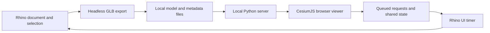

# Architecture

EarthLink has two processes: Rhino owns the document and geometry; a local Python server serves the browser and exchanges small JSON files with Rhino. The server listens on `127.0.0.1`; browser changes are queued for Rhino to apply on its UI timer.

| Component | Responsibility |
| --- | --- |
| `commands/` | Four Rhino entry points: send, viewer, sync, settings |
| `earthlink/core.py` | EarthAnchorPoint frame, design-set membership, headless GLB export, transformations, Earth Pro KML |
| `earthlink/views.py` | Perspective, two-point, and parallel cameras; two-way named-view reconciliation |
| `earthlink/sync.py` | Eto UI timer for live sets, cameras, anchor requests, sun, and named views |
| `earthlink/server.py` | Separate server process, local API, server-sent events, capture/share output |
| `earthlink/env.py` | Paths, defaults, settings, and OS helpers |
| `earthlink/collada.py` | GLB to Z-up COLLADA conversion for Earth Pro |
| `shared/viewer/index.html` | Viewer UI and CesiumJS integration; no frontend build step |
| `tools/build.py` | Rhino Script Editor build and Yak manifest/package finishing |

Geometry is exported in metres in a local east/north/up frame around the EarthAnchorPoint. Project identity and design-set membership are stored in Document User Text. Local runtime settings, credentials, views, and exchange files live in the user's application-data folder, outside the repository.

## Design constraints

- No Python background threads inside Rhino. Keep the server in its own process and document work on the UI timer.
- Export through a headless document so temporary export geometry does not enter the working model.
- Keep reciprocal features consistent: viewer location changes must reach EarthAnchorPoint, for example.
- Use `tools/build.py` because the Rhino command-line launcher requires a space-free build path.
- Keep the `.rhproj` library base as `earthlink/` and retain rendered 24-pixel light/dark command icons.

## Known preview issues

1. Ground height is currently a global setting and may carry over when switching projects. Re-sample at the new site.
2. A live set emptied by deleting all its objects can retain its last exported geometry. Remove the set from the viewer to clear it.
3. Browser-only exports can prune an older COLLADA file still referenced by Earth Pro. Re-export to Earth Pro.
4. The author reports testing public 0.1.0 in Rhino 8. Version 0.1.1 changes release metadata and documentation only; Windows validation remains unverified.

These issues are recorded, not fixed, in this initial preview preparation.
