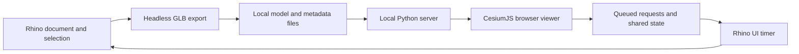

# Architecture

EarthLink has two processes: Rhino owns the document and geometry; a local Python server serves the browser and exchanges small JSON files with Rhino. The server listens on `127.0.0.1`; browser changes are queued for Rhino to apply on its UI timer.

| Component | Responsibility |
| --- | --- |
| `commands/` | Four Rhino entry points: send, viewer, sync, settings |
| `earthlink/core.py` | EarthAnchorPoint frame, design-set membership, headless GLB export, transformations, Earth Pro KML |
| `earthlink/views.py` | Perspective, two-point, and parallel cameras; two-way named-view reconciliation |
| `earthlink/sync.py` | Eto UI timer for live sets, cameras, anchor requests, sun, and named views |
| `earthlink/server.py` | Separate server process, local API, server-sent events, capture/share output |
| `earthlink/env.py` | Paths, defaults, settings, and OS helpers |
| `earthlink/geometry.py` | Final GLB to ENU-metre mesh sidecar for the map cutout, with node transforms baked |
| `shared/viewer/navigation.js` | Rhino-for-Mac trackpad and mouse navigation on the globe: gesture latching, easing, level horizon, scale-aware pan/zoom |
| `shared/viewer/footprints.js` | Plan outline of each set's base for "Hide map underneath": triangles cut 1 cm above the lowest point, painted on a grid, edges traced and straightened, in a worker; returns the clip polygons (grown by a margin) and the base's boundary rings for the map-to-model band (`buildSkirt` in index.html) |
| `shared/viewer/walk.js` | Walking: a 1.80 m person on whatever is drawn (map or model), probed by rays each frame |
| `earthlink/collada.py` | GLB to Z-up COLLADA conversion for Earth Pro |
| `shared/viewer/index.html` | Viewer UI and CesiumJS integration; no frontend build step |
| `tools/build.py` | Rhino Script Editor build and Yak manifest/package finishing |

Geometry is exported in metres in a local east/north/up frame around the EarthAnchorPoint. Project identity and design-set membership are stored in Document User Text. Local runtime settings, credentials, views, and exchange files live in the user's application-data folder, outside the repository.

## Design constraints

- No Python background threads inside Rhino. Keep the server in its own process and document work on the UI timer.
- Export through a headless document so temporary export geometry does not enter the working model.
- Keep reciprocal features consistent: viewer location changes must reach EarthAnchorPoint, for example.
- Use `tools/build.py` because the Rhino command-line launcher requires a space-free build path.
- Keep the `.rhproj` library base as `earthlink/` and retain rendered 24-pixel light/dark command icons.

## Known preview issues

1. Ground height is currently a global setting and may carry over when switching projects. Re-sample at the new site.
2. A live set emptied by deleting all its objects can retain its last exported geometry. Remove the set from the viewer to clear it.
3. Browser-only exports can prune an older COLLADA file still referenced by Earth Pro. Re-export to Earth Pro.
4. The author reports testing public 0.1.0 in Rhino 8. Version 0.1.1 changes release metadata and documentation only; Windows validation remains unverified.

The first three issues remain outside the viewer redesign. Windows acceptance is still pending.

## Viewer state and resources

`navigation.js` owns the camera: gestures latch one mode per gesture (including momentum), pivots are picked at the centre of the view when a gesture starts, motion is eased per frame and the horizon is re-levelled after every move. It works in world space, so it needs no site or model. Walk owns its own frame (east/north/up at the point you click) and returns to the prior camera on exit. Follow, site picking, set dragging, measurement and walking do not concurrently own input. Geometry/display changes leave walking. Two-Point keeps a level optical axis with bounded lens shift.

Each export optionally references a schema-1 geometry.json beside model.glb: ENU-metre vertices and triangle indices derived from the final GLB. A worker unions projected triangles and decomposes holes into simple Cesium 1.140 clipping polygons. Missing or failed sidecars produce a resend message, never a rectangular mask. Browser caches and set transforms keep the mask and collision geometry aligned. Share archives and Rhino project resources explicitly include the viewer modules and licensed runtime libraries.

Sun state includes enabled, UTC, timezone offset, source and project. Rhino is authoritative on sun-sync startup. Off uses neutral headlight illumination with no dynamic cast shadows; retained times do not reactivate it. JSON writes use unique temporary files and atomic replacement; viewer settings writes are serialized. The separate server may use request threads; Rhino uses no background Python threads.

Surface queries (orbit pivot, walking, walk placement) are CPU ray tests: EarthLink's own exported mesh through a uniform grid, and Google tiles through `tile.content.pick` limited to tiles within the probe's reach, with Cesium's GPU read-backs kept in memory for the session. Map hits inside a visible cutout are ignored. These use Cesium 1.140 internals (`_selectedTiles`, `Buffer.getBufferData`, the orthographic width adjustment, shadow bias), so an engine upgrade needs the browser checks again. Walking results are navigation aids, not geometric or accessibility validation.

Design-set placement (`geometry.compose_placement`) is a rotation about vertical plus a translation in east/north/up metres, stored per set in Document User Text and applied to the export after the EarthAnchorPoint transform. Rhino geometry is never moved by the viewer. Projection and cutout changes leave Walk before changing the scene. Live model loads carry a generation so an older delayed export cannot replace a newer model or its derived geometry.
