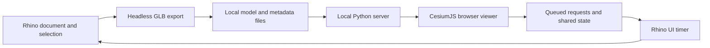

# Architecture

EarthLink has two processes: Rhino owns the document and geometry; a local Python server serves the browser and exchanges small JSON files with Rhino. The server listens on `127.0.0.1`; browser changes are queued for Rhino to apply on its UI timer.

| Component | Responsibility |
| --- | --- |
| `commands/` | Four Rhino entry points: send, viewer, sync, settings |
| `earthlink/core.py` | EarthAnchorPoint frame, design-set membership, headless GLB export, transformations, Earth Pro KML |
| `earthlink/views.py` | Perspective, two-point, and parallel cameras; two-way named-view reconciliation |
| `earthlink/sync.py` | Eto UI timer for live sets, cameras, anchor requests, sun, and named views |
| `earthlink/server.py` | Separate server process, local API, server-sent events, capture/share output |
| `earthlink/env.py` | Paths, defaults, settings, and OS helpers |
| `earthlink/geometry.py` | Final GLB to ENU-metre collision/footprint sidecar, with node transforms baked |
| `shared/viewer/navigation.js` | Site-local camera math and wheel normalization |
| `shared/viewer/footprints.js` | Projected-triangle union and hole decomposition in a worker |
| `shared/viewer/walking.js` | Rapier character motion, gravity, steps, collisions and jump state |
| `shared/viewer/map-contacts.js` | Transient bounded map contact probes; no tile-mesh extraction |
| `earthlink/collada.py` | GLB to Z-up COLLADA conversion for Earth Pro |
| `shared/viewer/index.html` | Viewer UI and CesiumJS integration; no frontend build step |
| `tools/build.py` | Rhino Script Editor build and Yak manifest/package finishing |

Geometry is exported in metres in a local east/north/up frame around the EarthAnchorPoint. Project identity and design-set membership are stored in Document User Text. Local runtime settings, credentials, views, and exchange files live in the user's application-data folder, outside the repository.

## Design constraints

- No Python background threads inside Rhino. Keep the server in its own process and document work on the UI timer.
- Export through a headless document so temporary export geometry does not enter the working model.
- Keep reciprocal features consistent: viewer location changes must reach EarthAnchorPoint, for example.
- Use `tools/build.py` because the Rhino command-line launcher requires a space-free build path.
- Keep the `.rhproj` library base as `earthlink/` and retain rendered 24-pixel light/dark command icons.

## Known preview issues

1. Ground height is currently a global setting and may carry over when switching projects. Re-sample at the new site.
2. A live set emptied by deleting all its objects can retain its last exported geometry. Remove the set from the viewer to clear it.
3. Browser-only exports can prune an older COLLADA file still referenced by Earth Pro. Re-export to Earth Pro.
4. The author reports testing public 0.1.0 in Rhino 8. Version 0.1.1 changes release metadata and documentation only; Windows validation remains unverified.

The first three issues remain outside the viewer redesign. The development preview adds tested navigation/footprints/physics and sun enabled-state synchronization; it does not constitute fresh installed-Rhino or Windows acceptance.

## Viewer state and resources

A single site-local camera state drives gestures and sliders. Walk owns a separate physical body and returns to the prior orbit camera on exit. Follow, site picking, set dragging, measurement and walking do not concurrently own input. Geometry/display changes leave walking. Two-Point keeps a level optical axis with bounded lens shift.

Each export optionally references a schema-1 geometry.json beside model.glb: ENU-metre vertices and triangle indices derived from the final GLB. A worker unions projected triangles and decomposes holes into simple Cesium 1.140 clipping polygons. Missing or failed sidecars produce a resend message, never a rectangular mask. Browser caches and set transforms keep the mask and collision geometry aligned. Share archives and Rhino project resources explicitly include the viewer modules and licensed runtime libraries.

Sun state includes enabled, UTC, timezone offset, source and project. Rhino is authoritative on sun-sync startup. Off uses neutral headlight illumination with no dynamic cast shadows; retained times do not reactivate it. JSON writes use unique temporary files and atomic replacement; viewer settings writes are serialized. The separate server may use request threads; Rhino uses no background Python threads.

Map contacts use a bounded neighborhood around the person's feet, with short-lived in-memory query reuse and stale-result guards. Contact queries use guarded private Cesium 1.140 ray APIs, so an engine upgrade requires dedicated regression checks. Unknown support stops motion instead of inferring a surface. Physics and sampled Google context are visual navigation aids, not geometric or accessibility validation.

Leaving Walk closes its query adapter permanently and restores the shared offscreen frustum. A cancelled or timed-out sampling phase cannot acquire a later session's adapter. Projection and cutout changes leave Walk before changing the scene. Live model loads carry a generation so an older delayed export cannot replace a newer model or its derived geometry.
