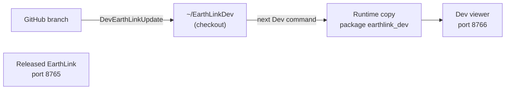
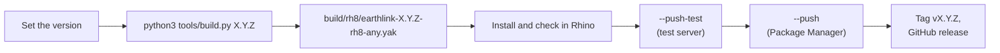

# Development

## Set up

You need Python 3.9 or newer and Node 20 or newer. Rhino 8 is only needed to build the package and to try commands.

```sh
git clone https://github.com/J1mmywzh/EarthLink.git
cd EarthLink
python3 -m pip install pytest
```

## Test

```sh
python3 -m pytest -q tests                      # server, site import, export maths (no Rhino needed)
node --test tests/navigation.test.cjs tests/walk.test.cjs tests/footprints.test.cjs
```

Browser tests run the real viewer in Chromium against a fixture server with a temporary data folder and no map key:

```sh
npm install playwright@1.65.0 && npx playwright install chromium
python3 tests/serve_fixture.py --port 8765 &
node tests/viewer_smoke.mjs http://127.0.0.1:8765/
node --test tests/viewer_controls.cjs           # gestures with real wheel events
node --test tests/viewer_review.cjs             # every panel and tool
```

Set `EARTHLINK_PLAYWRIGHT` or `EARTHLINK_CHROME` if Playwright or the browser live elsewhere. Run the gesture tests locally before a release: they are timing-sensitive on CI's software renderer. CI (`.github/workflows/ci.yml`) runs the Python and Node tests on Linux, Windows and macOS, and the smoke test on Linux.

What automation cannot check: the feel of a real trackpad, the streamed map on a real graphics card, and the installed plugin in Rhino. Check these by hand before a release (see the checklist below).

## Try changes in Rhino: EarthLink Dev

EarthLink Dev is a second plugin that runs the code of a source checkout beside the released EarthLink, so you can try a branch without building or replacing anything.



- **Build it once** with Rhino running: `python3 tools/build_dev.py`. Then drag `build_dev/EarthLinkDev.rhp` into Rhino.
- **Commands:** `DevSendToEarth`, `DevEarthLinkViewer`, `DevEarthLinkSync` and `DevEarthLinkSettings`, plus `DevEarthLinkUpdate`, which moves the checkout to a branch.
- **The checkout** is `~/EarthLinkDev` (or `EARTHLINK_DEV_SRC`). After an update or an edit there, the next Dev command loads the new code without restarting Rhino.
- **Kept apart:** port 8766, the data folder `EarthLink Dev`, the file section `EarthLinkDev` and its own sync timer. The map key is copied once from the released settings.
- **Shared, because Rhino holds them:** the EarthAnchorPoint, named views and the Sun.
- **Turn it off** under Rhino's Options > Plug-ins.

`tools/devloader.py` holds the rules that keep the two apart; `tests/test_devloader.py` checks them.

## Build and release



```sh
python3 tools/build.py 1.0.0              # needs Rhino 8 running
python3 tools/build.py 1.0.0 --push-test  # McNeel's test server
python3 tools/build.py 1.0.0 --push       # Package Manager, for everyone
```

- The version in `EarthLink.rhproj`, `earthlink/__init__.py`, the manifest and the archive name must agree. A published version can never be replaced, so every release needs a new number.
- Keep the plugin id unchanged.
- Pushing needs Yak authentication and publishes for everyone; it is a deliberate, separate step.
- Every viewer file and license must be listed in `EarthLink.rhproj` resources and `server.VIEWER_ASSETS`. After adding one, check a built package and a shared viewer ZIP.
- `tools/build.py` is required because Rhino's builder needs a build path without spaces and flattens resource folders; `finish_package()` restores them.

### Release checklist

1. All tests pass, including the browser tests run locally.
2. Install the built package in Rhino 8 on a Mac and on Windows, then check these:
   - Send a model.
   - Live updates.
   - Named views both ways.
   - Sun sync.
   - Capture.
   - Surroundings import.
3. Check trackpad and mouse navigation on the real map.
4. Update `CHANGELOG.md`, push to the test server, then to Package Manager.
5. Tag the commit and publish the GitHub release with the package attached.

## Working rules

- Rhino owns the document: change it only on the sync timer, never from a background thread.
- Never export the photorealistic map; site geometry comes from open data only.
- Navigation in `navigation.js` is the only thing that moves the camera. Tune speeds in `RATE`; keep one gesture to one mode.
- Do not commit settings, map keys, exported models, captures or real project locations. The test coordinates (42.4405, −76.5108) are a placeholder.
- Pull before you edit, and commit and push finished work. Git does not carry local settings or Rhino runtime data between computers.
